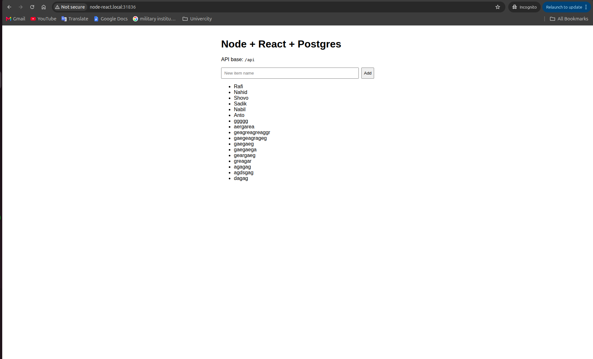
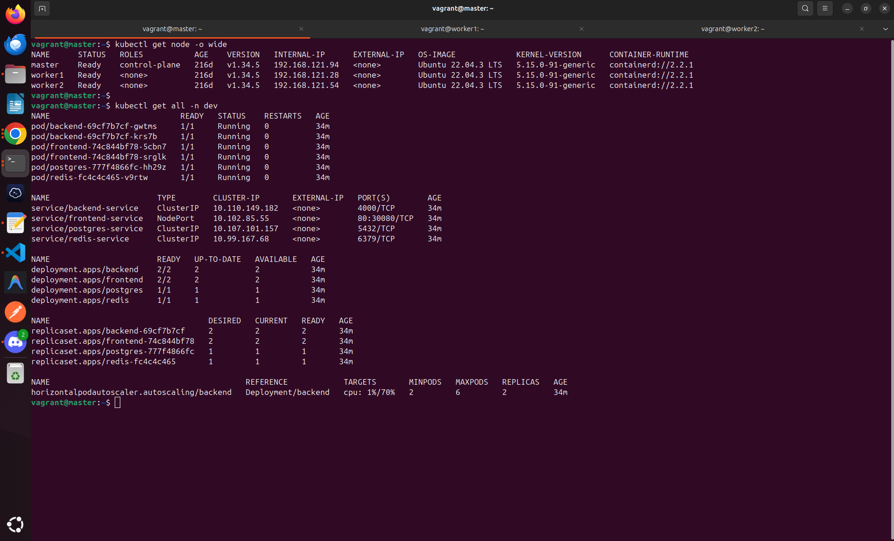
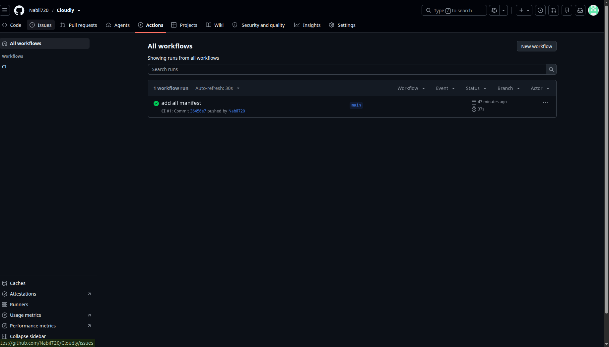
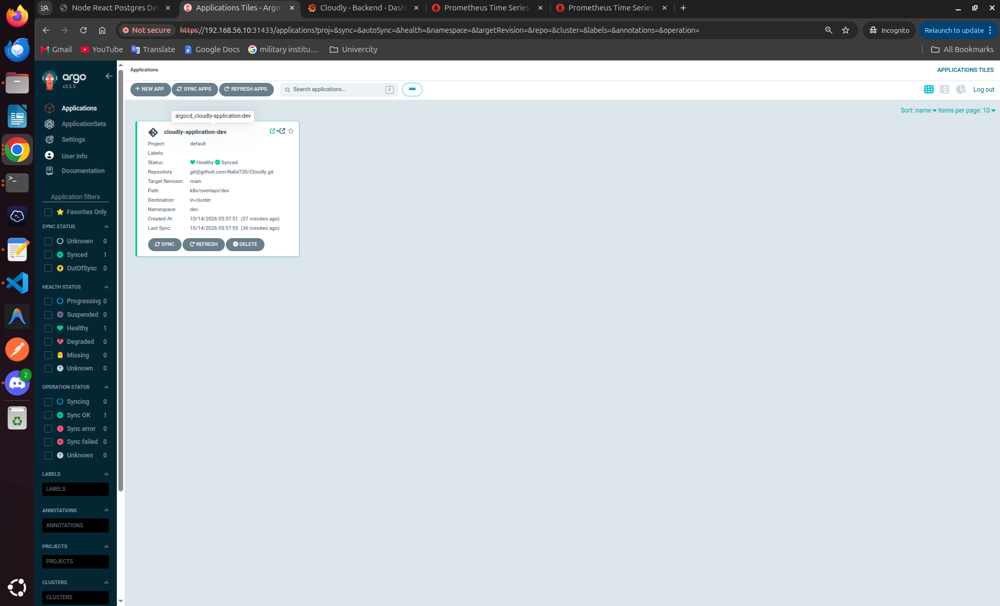
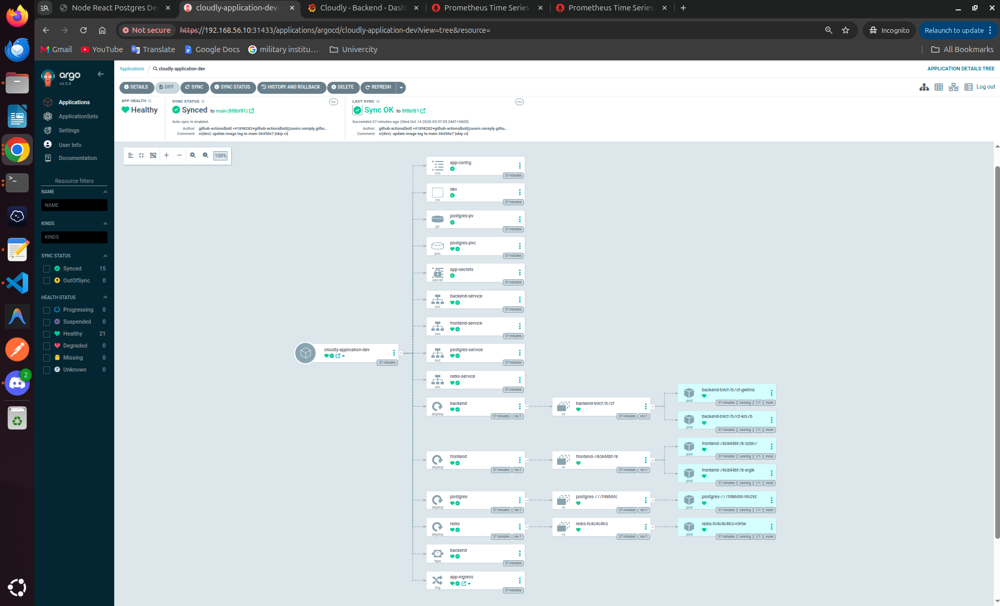
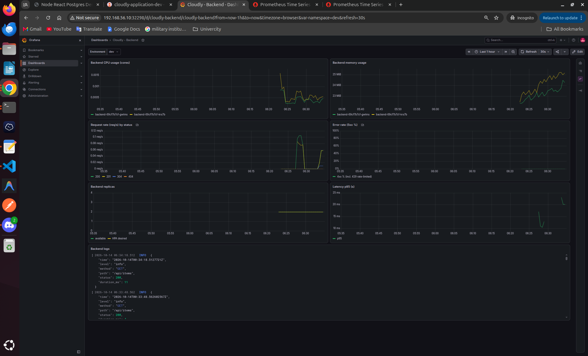
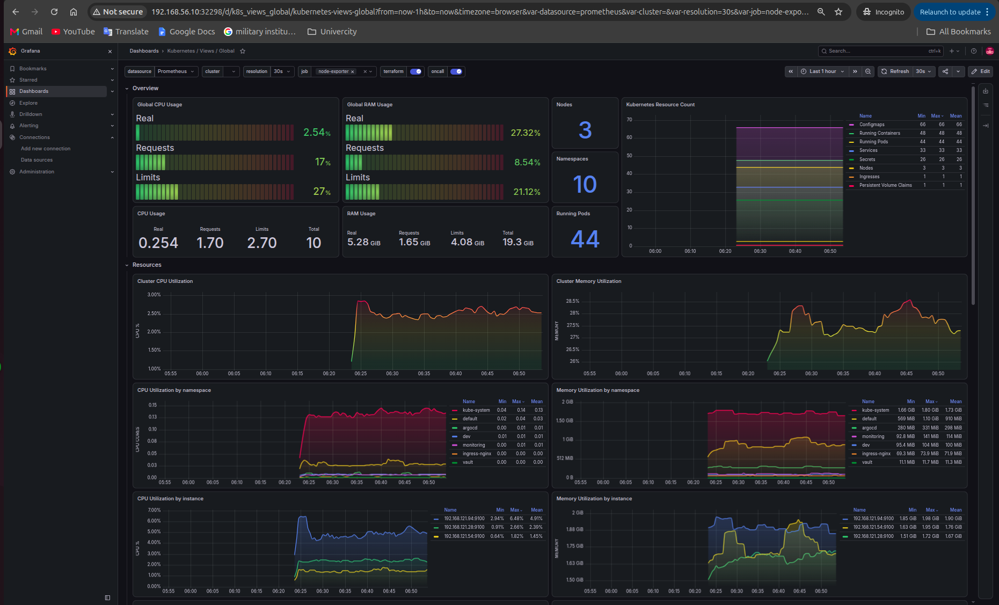
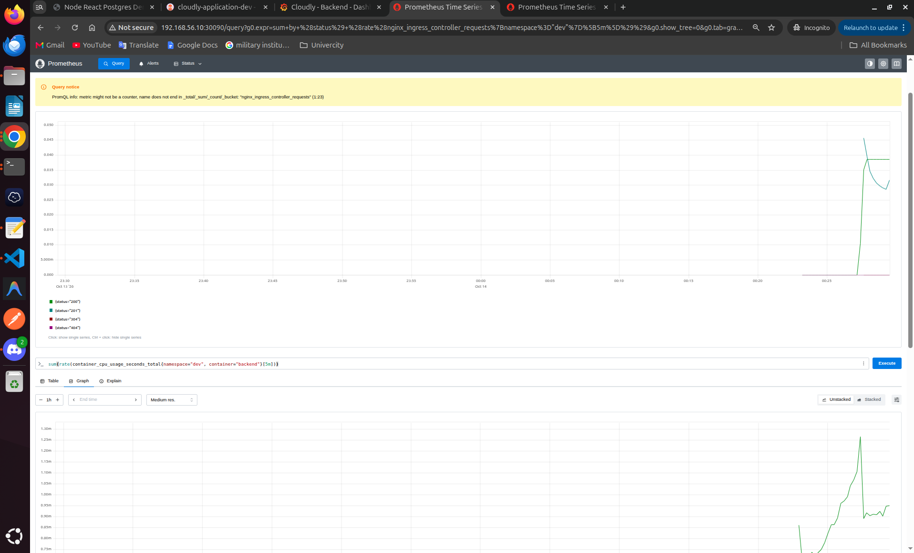
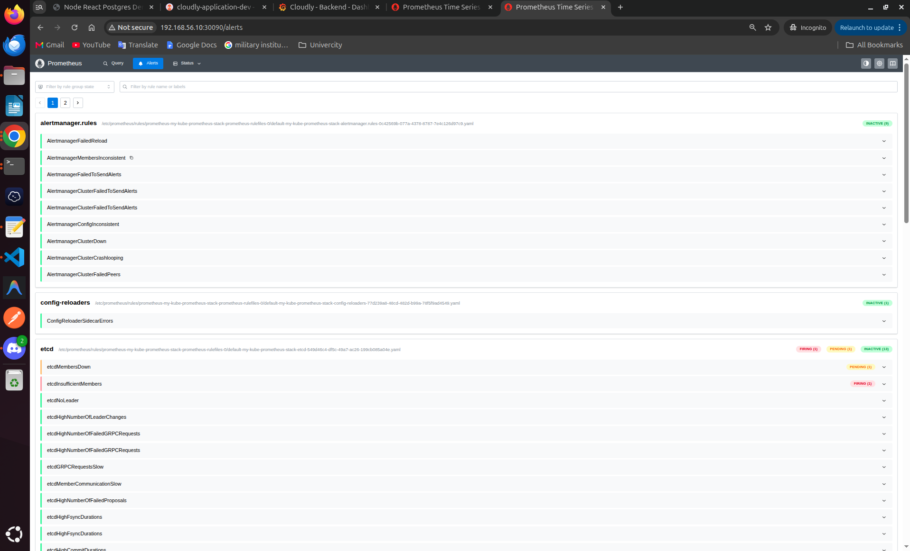

# Cloudly — Node + React + PostgreSQL on Kubernetes

A full-stack app (React frontend, Node.js/Express backend, PostgreSQL, Redis) that runs
with Docker Compose and on Kubernetes, with CI/CD, Argo CD, monitoring, logging,
autoscaling and rate limiting.

> **Cluster:** everything runs on my **local kubeadm Kubernetes cluster**
> (1 master + 2 workers, Ubuntu VMs created with Vagrant, Kubernetes v1.34, Cilium CNI)



---

## Contents

1. [Prerequisites and Quick Start](#1-prerequisites-and-quick-start)
2. [Project Structure](#2-project-structure)
3. [Docker Compose](#3-docker-compose)
4. [Kubernetes](#4-kubernetes)
5. [Request Path and DNS](#5-request-path-and-dns)
6. [Debugging](#6-debugging)
7. [CI/CD and Rollback](#7-cicd-and-rollback)
8. [Redis and Read/Write DB](#8-redis-and-readwrite-db)
9. [Monitoring, Logging and Scaling](#9-monitoring-logging-and-scaling)
10. [Design Decisions](#10-design-decisions)

---

## 1. Prerequisites and Quick Start

| Tool | Used for |
|------|----------|
| Docker + Docker Compose | running locally |
| Kubernetes cluster | I use my local kubeadm cluster (3 nodes) |
| kubectl, helm | deploying to the cluster |
| Argo CD | GitOps deployment |
| Docker Hub account | storing images (`nanil0034/cloudly-*`) |

**Docker Compose: one command**

```bash
cp .env.example .env && docker compose up --build
```

Open http://localhost:8080

**Kubernetes: one command** (after the one-time setup in [section 4](#4-kubernetes))

```bash
kubectl apply -k k8s/overlays/dev
```

Open http://node-react.local:31836

---

## 2. Project Structure

```
.
├── backend/                 Express API, Dockerfile, .dockerignore
├── frontend/                React app, nginx config, Dockerfile, .dockerignore
├── docker-compose.yml       local stack
├── .env.example             settings template
├── k8s/
│   ├── base/                shared manifests
│   └── overlays/            dev / preprod / release
├── observability/           alerts, Grafana dashboard, Loki, Fluent Bit
├── .github/workflows/       CI pipeline
└── docs/                    screenshots
```

The Dockerfiles are inside `backend/` and `frontend/`, so each image builds from its
own folder with its own `.dockerignore`.

---

## 3. Docker Compose

**Run**

```bash
cp .env.example .env            # create the settings file (first time only)
docker compose up -d --build    # build the images and start everything in the background
docker compose ps               # check that all services are running
docker compose logs -f backend  # follow the backend logs
```

**Stop**

```bash
docker compose down             # stop and remove containers, keep the data
docker compose down -v          # stop and also delete the database and Redis data
```

| Service | Address | Notes |
|---------|---------|-------|
| frontend | http://localhost:8080 | nginx serves React and forwards `/api` to the backend |
| backend | http://localhost:4000/api/health | Express API |
| postgres | internal | data kept in the `postgres_data` volume |
| redis | internal | data kept in the `redis_data` volume |

- **Small images:** multi-stage builds. The backend runs as a non-root user; the
  frontend image has only nginx and the built files.
- **Config:** all settings come from `.env`, and nothing is hardcoded in the images.
- **Startup order:** the backend waits until Postgres and Redis are healthy.
- **Data:** volumes survive `docker compose down`; `docker compose down -v` deletes them.

---

## 4. Kubernetes



**One-time setup**

```bash
# ingress controller
kubectl apply -f https://raw.githubusercontent.com/kubernetes/ingress-nginx/controller-v1.14.0/deploy/static/provider/baremetal/deploy.yaml

# hostname on your machine
echo "192.168.56.10 node-react.local" | sudo tee -a /etc/hosts
```

**Manifests**

```
k8s/base/
├── configuration/   ConfigMap + Secret
├── storage/         PersistentVolume + PersistentVolumeClaim
├── postgres/        Deployment + Service
├── redis/           Deployment + Service
├── backend/         Deployment + Service + HPA
├── frontend/        Deployment + Service
└── ingress/         Ingress
```

| Environment | Namespace | Hostname |
|-------------|-----------|----------|
| dev | `dev` | `node-react.local` |
| preprod | `preprod` | `preprod.node-react.local` |
| release | `release` | `release.node-react.local` |

- **Internal only:** Postgres, Redis and backend use ClusterIP Services. From outside,
  you can reach only the Ingress and the frontend NodePort (30080).
- **Config and secrets:** settings live in ConfigMap `app-config`, DB user and password
  in Secret `app-secrets`.
- **Storage:** Postgres uses a PV/PVC, so data is kept when the pod restarts.
- **Health checks:**
  - liveness `/api/health/live` checks whether the app is running
  - readiness `/api/health/ready` checks whether the app can reach the DB

---

## 5. Request Path and DNS

```
Browser → Ingress (ingress-nginx) → Service (ClusterIP) → Pod → PostgreSQL
```

1. The browser opens `node-react.local`, which points to the node IP.
2. The Ingress controller checks the path: `/api` goes to `backend-service`,
   and `/` goes to `frontend-service`.
3. The Service sends the request to a **ready** backend pod.
4. The backend connects to `postgres-service`, which forwards to the Postgres pod.

**How DNS works:** every Service gets a name in CoreDNS:

| Name | Works from |
|------|------------|
| `postgres-service` | the same namespace |
| `postgres-service.dev` | any namespace |
| `postgres-service.dev.svc.cluster.local` | anywhere (full name) |

Pod IPs change on every restart, but Service names stay the same, so apps always use
Service names.

---

## 6. Debugging

### Ingress works, but the backend does not

```bash
kubectl get ingress -n dev
kubectl get endpoints backend-service -n dev   # empty = no ready backend pods
kubectl get pods -n dev -l app=backend
kubectl logs -n dev deploy/backend
```

| What you see | Meaning |
|--------------|---------|
| `404` | no Ingress rule matched (wrong host or path) |
| `502` / `503` | no ready backend pod |
| pods `0/1` | readiness fails, usually because Postgres is down |
| pods `1/1` but no endpoints | Service selector does not match the pod labels |


---

## 7. CI/CD and Rollback

```
git push → GitHub Actions → build + push images to Docker Hub
         → update image tag in k8s/overlays/<env> → Argo CD deploys it
```

**CI: GitHub Actions** ([`.github/workflows/ci-cd.yml`](.github/workflows/ci-cd.yml))

| Branch | Deploys to | Image tag |
|--------|------------|-----------|
| `main` | dev | `main-<sha>` |
| `pre-release/v*` | preprod | `pre-release-v1.0.0-<sha>` |
| `release/v*` | release | `release-v1.0.0-<sha>` |



**CD: Argo CD** watches `k8s/overlays/dev` and syncs every change to the cluster.





**CI secrets:** stored in GitHub (Settings > Secrets and variables > Actions):

| Secret | Value |
|--------|-------|
| `DOCKERHUB_USERNAME` | Docker Hub username |
| `DOCKERHUB_TOKEN` | Docker Hub access token, not the password |

The pipeline never gets cluster access. It only pushes to Docker Hub and Git, and
Argo CD pulls the changes from inside the cluster.

**Rollback**

1. `git revert` the image tag commit and push. Argo CD deploys the old version (recommended).
2. Or use Argo CD > History and Rollback.
3. In an emergency: `kubectl rollout undo deployment/backend -n dev`, then a git revert.

---

## 8. Redis and Read/Write DB

> For this task I worked on the **Redis** part.

**Redis**

- Manifests: `k8s/base/redis/` (Deployment + ClusterIP Service).
- The backend connects with `REDIS_URL=redis://redis-service:6379`.
- Internal only: no NodePort and no Ingress rule.

**Read/write DB routing**

- The routing is in the app code (`backend/src/db.js`):
  - writes (`INSERT`, `UPDATE`, `DELETE`) use `DB_WRITE_URL` (the primary)
  - reads (`SELECT`) use `DB_READ_URL` (the replica)
- Another option is a DB proxy (e.g. Pgpool-II), which keeps the app simpler but is one
  more thing to run.

**Replication lag**

- A replica is always a little behind the primary, so reading right after a write can
  return old data.
- These must always use the **primary**:
  - all writes
  - reading data you just wrote
  - checks before a write (e.g. is a username taken)

---

## 9. Monitoring, Logging and Scaling

| Tool | URL |
|------|-----|
| Grafana | http://192.168.56.10:32298 |
| Prometheus | http://192.168.56.10:30090 |

**Setup**

```bash
helm install my-kube-prometheus-stack prometheus-community/kube-prometheus-stack -n default \
  --set grafana.service.type=NodePort --set grafana.service.nodePort=32298 \
  --set prometheus.service.type=NodePort --set prometheus.service.nodePort=30090 \
  --set grafana.sidecar.dashboards.searchNamespace=ALL
kubectl apply -k observability/
```

### Metrics

Dashboard **Cloudly - Backend**: CPU, memory, requests per second, error rate,
p95 latency, replicas and logs.







### Alerts

| Alert | Fires when | Why |
|-------|-----------|-----|
| High error rate | 5xx > 5% for 5 min | users are getting errors |
| High latency | p95 > 1s for 10 min | the app is slow |
| High CPU | > 90% of the limit for 10 min | pods are throttled |
| At max replicas | HPA at 6 for 15 min | no room left to scale |
| Pod restarting | > 3 restarts in 15 min | crash loop |



### Logging

```
container logs → Fluent Bit (on every node) → Loki → Grafana
```

In Grafana > Explore > Loki:

```
{namespace="dev", app="backend"}                          # all backend logs
{namespace="dev", app="backend"} | json | status >= 400   # only errors
```

### Autoscaling

- The HPA keeps **2 to 6** backend pods and targets 70% CPU.
- Tested: under load it scaled from 2 to 6 pods.

### Rate limiting

- Set on the Ingress: **10 requests/s per IP**, bursts up to 50, max 20 connections.
- Extra requests get `429 Too Many Requests`.
- Tested: out of 100 requests at once, 20 passed and 80 got `429`.

---

## 10. Design Decisions

| Decision | Why |
|----------|-----|
| Local kubeadm cluster | a real multi-node cluster, closer to production than kind/minikube |
| Kustomize overlays | one set of manifests for all environments |
| Argo CD (GitOps) | Git is the source of truth; rollback is a `git revert` |
| Image tag = branch + SHA | every image points to one commit |
| Metrics and rate limiting at the Ingress | no app code needed |


